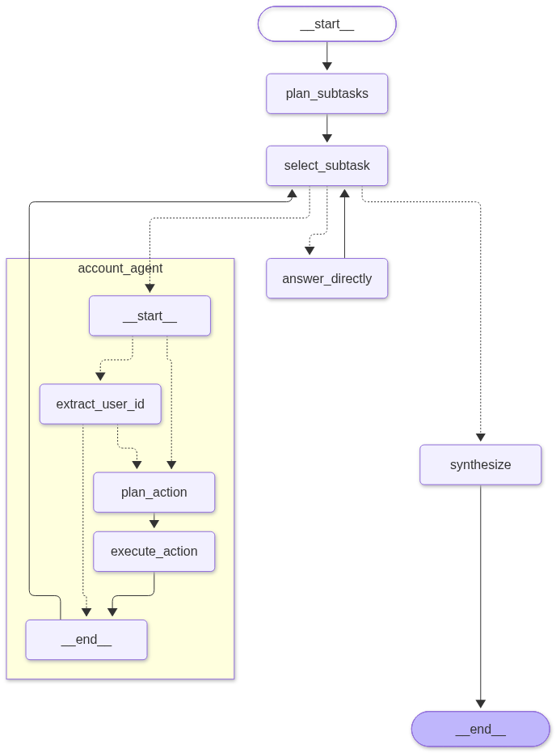

# Coordinator-subagent demo

A **LangGraph** demo. A **coordinator** splits a user prompt into subtasks. It sends each subtask to a **subagent**. It combines the results into one answer.

**Example:** `Cancel user 101 and tell me the capital of France.`

- `account_agent` cancels user `101`.
- The coordinator answers "Paris".
- The final answer covers both.

## main_agent



**Purpose:** the coordinator. It plans, routes, monitors and combines.

- **plan_subtasks:** the LLM splits the prompt into subtasks. It assigns an agent to each.
- **select_subtask:** picks the next pending subtask. Routes it to an agent. No pending subtask goes to `synthesize`.
- **account_agent / answer_directly:** run the subtask. Then back to `select_subtask`.
- **synthesize:** writes one final answer. It names failed subtasks.

## account_agent

**Purpose:** the subagent. It turns an account request into an **MCP** tool call.

- **extract_user_id:** reads the user ID from the prompt. Fails if there is none.
- **plan_action:** the LLM picks an MCP tool.
- **execute_action:** calls the tool.

## MCP server

**Purpose:** gives `account_agent` tools to manage SaaS subscriptions. Code: `MCP/account_manager/`.

- Built with `fastmcp`. Runs over stdio. `account_agent` starts it on each call.
- Stores data in **SQLite**. Seed data: `101` Alice (active), `102` Bob (inactive).
- Tools:
  - `list_subscriptions`: list all accounts.
  - `get_subscription`: get one account by user ID.
  - `set_subscription_state`: activate or cancel an account.
- An unknown user ID returns an error.

## Run

Create `.env` in this folder:

```
BASE_URL=http://localhost:11434/v1
API_KEY=ollama
MODEL=qwen3:4b-instruct
```

Start:

```
python main.py
```
